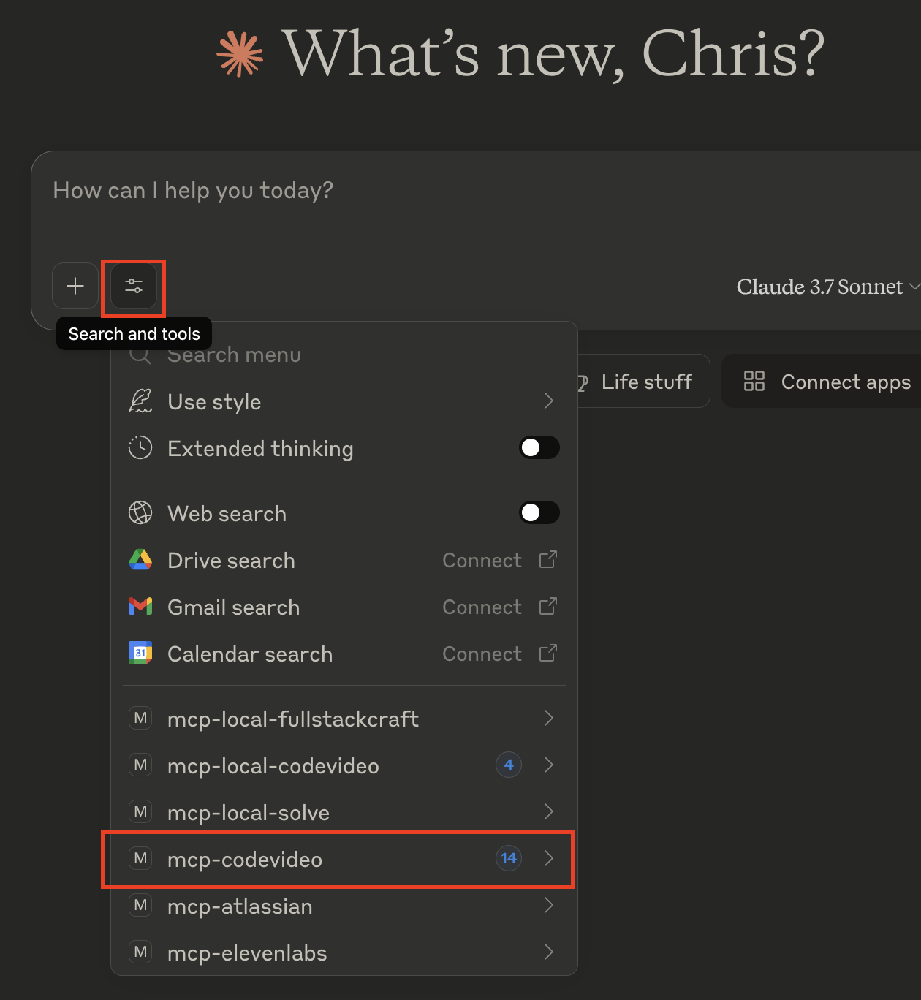

# codevideo-mcp

The MCP server for CodeVideo. 

Create software educational content using natural language.

## Examples:

Creation:

- "Build a video lesson on how to use the `useState` hook in React"
- "Can you create a video lesson compare and contrasting how to program concurrently in C#, Go, and Rust?"
- Can you give me a markdown blog post on how to use the `useState` hook in React?"

Conversion:

- "Please convert these CodeVideo JSON actions to a video"
- "Convert these CodeVideo JSON actions to a blog post"
- "Convert these CodeVideo JSON actions to HTML"
- "Can you convert this English-based lesson to Spanish?"

Validation:

- "Are these CodeVideo JSON actions valid?"

## Usage with Claude Desktop

The npm package installs the matching native CodeVideo CLI automatically. Video rendering also requires Chrome/Chromium and FFmpeg; validate the host first with:

```shell
npx @fullstackcraftllc/codevideo-cli doctor
```

If Chrome is not detected, run `npx @fullstackcraftllc/codevideo-cli install-browser`. `PATH_TO_CODEVIDEO_CLI` remains available as an optional override for local CLI builds.

Simply drop the following into your `claude_desktop_config.json` file:

```json
{
    // ... other MCP servers
    "codevideo-mcp": {
        "command": "npx",
        "args": [
            "-y",
            "@fullstackcraftllc/codevideo-mcp@latest"
        ],
        "env": {
            "ELEVEN_LABS_API_KEY": "your-elevenlabs-api-key",
            "ELEVEN_LABS_VOICE_ID": "your-elevenlabs-voice-id"
        }
    },
    // ... other MCP servers
}
```

## Usage with Codex

Add the published MCP server to `~/.codex/config.toml`:

```toml
[mcp_servers.codevideo]
command = "npx"
args = ["-y", "@fullstackcraftllc/codevideo-mcp@1.0.4"]
startup_timeout_sec = 60
tool_timeout_sec = 1200
env_vars = ["ELEVEN_LABS_API_KEY", "ELEVEN_LABS_VOICE_ID", "GEMINI_API_KEY"]
```

Restart Codex or open a new thread after changing MCP configuration.

Be sure to restart Claude after modifying this config! 

After restarting Claude Desktop, if installation was successful, you should see `codevideo-mcp` in the list of installed MCPs:



## Local Development

Clone this repository:

```shell
git clone https://github.com/codevideo/codevideo-mcp.git
```

Then, install the dependencies and build the project:

```shell
cd codevideo-mcp
npm install
npm run build
```

Then, use the following JSON to run the local version on your Claude Desktop:

```json
    // ... other MCP servers
    "codevideo-mcp": {
        "command": "npx",
        "args": [
            "tsx",
            "/path/to/your/clone/of/codevideo-mcp/src/index.ts"
        ],
        "env": {
            "ELEVEN_LABS_API_KEY": "your-elevenlabs-api-key",
            "ELEVEN_LABS_VOICE_ID": "your-elevenlabs-voice-id"
        }
    }
    // ... other MCP servers
```

## Known Issues

- Currently, creating entire courses seems to be a bit flakey and perhaps too large for the context window for Claude. We're working on refining the full course flow. Single lesson, or action array generation both seem to work well.
