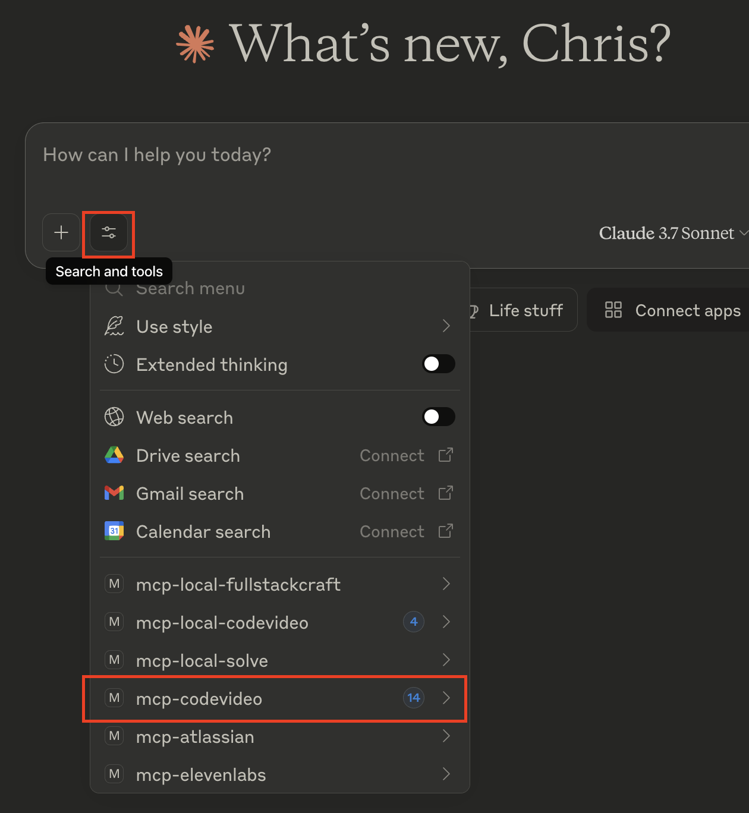

# codevideo-mcp

The MCP server for CodeVideo. 

Create software educational content using natural language.

## Examples:

Creation:

- "Build a video lesson on how to use the `useState` hook in React"
- "Can you create a video lesson compare and contrasting how to program concurrently in C#, Go, and Rust?"
- Can you give me a markdown blog post on how to use the `useState` hook in React?"

Conversion:

- "Please convert these CodeVideo JSON actions to a video"
- "Convert these CodeVideo JSON actions to a blog post"
- "Convert these CodeVideo JSON actions to HTML"
- "Can you convert this English-based lesson to Spanish?"

Validation:

- "Are these CodeVideo JSON actions valid?"

## Requirements

- Node.js 22.13 or newer. The MCP keeps its data in SQLite through Node's built-in `node:sqlite`, so nothing native is compiled on install.
- For videos: the npm package installs the matching native CodeVideo CLI automatically, and rendering also needs Chrome/Chromium and FFmpeg.
- For narration, one of:
  - **ElevenLabs:** `ELEVEN_LABS_API_KEY` (and optionally `ELEVEN_LABS_VOICE_ID`). The CLI uploads each clip to CodeVideo's S3 bucket, so this also needs `CODEVIDEO_S3_KEY_ID` and `CODEVIDEO_S3_SECRET` with access to it.
  - **Kokoro** (self-hosted, no cloud account): `CODEVIDEO_TTS_PROVIDER=kokoro` and `TTS_SERVICE_URL` pointing at a codevideo-tts (Kokoro) service. Clips are embedded in the video job directly.

## Usage with Claude Desktop

Validate the host first with:

```shell
npx @fullstackcraftllc/codevideo-cli doctor
```

If Chrome is not detected, run `npx @fullstackcraftllc/codevideo-cli install-browser`. `PATH_TO_CODEVIDEO_CLI` remains available as an optional override for local CLI builds.

Add the server under `mcpServers` in your `claude_desktop_config.json` file, next to any others you have:

```json
{
    "mcpServers": {
        "codevideo-mcp": {
            "command": "npx",
            "args": [
                "-y",
                "@fullstackcraftllc/codevideo-mcp@latest"
            ],
            "env": {
                "CODEVIDEO_TTS_PROVIDER": "kokoro",
                "TTS_SERVICE_URL": "http://localhost:3000"
            }
        }
    }
}
```

(Or the ElevenLabs and S3 variables from [Requirements](#requirements) instead of the two Kokoro ones.)

## Usage with Claude Code

```shell
claude mcp add codevideo -e CODEVIDEO_TTS_PROVIDER=kokoro -e TTS_SERVICE_URL=http://localhost:3000 -- npx -y @fullstackcraftllc/codevideo-mcp@latest
```

Pass the ElevenLabs and S3 variables with `-e` instead of the two Kokoro ones if you use ElevenLabs.

## Usage with Codex

Add the published MCP server to `~/.codex/config.toml`:

```toml
[mcp_servers.codevideo]
command = "npx"
args = ["-y", "@fullstackcraftllc/codevideo-mcp@latest"]
startup_timeout_sec = 60
env_vars = ["CODEVIDEO_TTS_PROVIDER", "TTS_SERVICE_URL", "ELEVEN_LABS_API_KEY", "ELEVEN_LABS_VOICE_ID", "CODEVIDEO_S3_KEY_ID", "CODEVIDEO_S3_SECRET", "GEMINI_API_KEY"]
```

Restart Codex or open a new thread after changing MCP configuration.

Be sure to restart Claude after modifying this config! 

After restarting Claude Desktop, if installation was successful, you should see `codevideo-mcp` in the list of installed MCPs:



## Building a course

For anything longer than one lesson, start with the `codevideo_instructions_to_build_course_from_scratch` prompt tool. The course lives in the MCP, keyed by id, so the model writes each lesson's actions once and never carries snapshots or earlier lessons in its context:

1. `codevideo_create_course` returns a `courseId`; `codevideo_add_lesson` adds lessons, each continuing from the previous one's final state by default.
2. `codevideo_set_lesson_actions` stores a lesson's actions. To change part of a lesson later, `codevideo_edit_lesson_actions` applies splice-style edits, and `codevideo_get_lesson_actions` reads actions back a slice at a time.
3. `codevideo_get_lesson_file_tree`, `codevideo_get_lesson_file` and `codevideo_compile_lesson` read and check the code at the end of a lesson without pulling snapshots.
4. `codevideo_validate_course` returns `done: true` once every lesson is valid, continuous, and compiles where it should. Previews and videos refuse to run before that. It also rejects actions that change files with nothing on screen causing them (`file-explorer-create-file` and similar), because in the video the file would just appear. Lessons make files with the mouse (right-click, New File) or with `touch` in the terminal.
5. `codevideo_generate_course_previews` writes an HTML page per lesson to review; `codevideo_render_course_videos` then renders every lesson.
6. `codevideo_get_course_status` shows where things stand, with an estimated length per lesson; `codevideo_export_course` writes the whole course to a JSON file and returns its path.

The model learns the actions from `codevideo_get_action_names`, which lists each one with what it does and what its value takes, straight from codevideo-types.

The older single-slot tools (`codevideo_set_current_actions`, `codevideo_set_current_lesson` and the tools that read them) still work for single videos. Every conversation shares their one slot, though, so use the course tools for anything bigger.

## Rendering videos

Every video tool (`codevideo_make_video_from_actions`, `codevideo_make_video_from_lesson`, `codevideo_render_lesson_video`, `codevideo_render_course_videos`) queues a render job and returns at once with a `jobId`. A background worker renders the queue one video at a time, and keeps going if you close Claude or Codex.

- `codevideo_get_render_job` shows a job's status (queued, running, succeeded, failed, cancelled or interrupted), its latest progress line, the saved file, any error, and the end of the CLI's log.
- `codevideo_list_render_jobs` lists recent jobs, for one course or all.
- `codevideo_cancel_render_job` cancels one job, or everything unfinished in a course, stopping the browser too.

All four video tools take the same `options`:

| Option | Values |
| --- | --- |
| `orientation` | `landscape` (default) or `portrait` (1080×1920) |
| `theme` | `dark` or `light` |
| `isFileExplorerVisible`, `isTerminalVisible`, `isEditorTabsVisible`, `isMinimapVisible`, `isMouseVisible`, `withCaptions` | `true` / `false`; for portrait, usually hide the explorer, tabs, minimap and mouse |
| `fontSizePx`, `fileExplorerWidth`, `terminalHeight`, `mouseColor`, `wordWrap`, `defaultLanguage` | IDE layout |
| `keyboardTypingPauseMs`, `standardPauseMs`, `longPauseMs` | pacing |
| `voiceId`, `ttsProvider` | narration voice and provider |
| `renderMode` | `realtime` (default) or `deterministic`; `renderSeed` and `renderWorkers` (1–32) apply to deterministic renders |
| `isDiagnosticsVisible` | `true` / `false`: TypeScript squiggles in the editor from the start; lessons can also turn them on and off with `editor-show-diagnostics` and `editor-hide-diagnostics` |

They also take `open`: whether to open the finished video in your default player. It defaults to on for single videos and off for whole courses.

Videos are saved to `CODEVIDEO_OUTPUT_DIR`, or your Desktop.

## Where your data lives

Everything is under `~/.codevideo/`, or the folder `CODEVIDEO_HOME` points to:

- `codevideo.db`: courses, lessons, the legacy single slot, and the render queue.
- `jobs/<jobId>/`: each render's project, settings and CLI logs (`stdout.log`, `stderr.log`); `jobs/worker.log` is the worker's own log.
- `exports/`: course exports.
- `previews/`: lesson previews.

## Local Development

Clone this repository:

```shell
git clone https://github.com/codevideo/codevideo-mcp.git
```

Then, install the dependencies and build the project:

```shell
cd codevideo-mcp
npm install
npm run build
```

Run the tests (type-check, unit and integration tests with a fake CLI, and the token-flatness check) with:

```shell
npm run type-check
npm test
```

Then, use the following JSON to run the local version on your Claude Desktop:

```json
    // ... other MCP servers
    "codevideo-mcp": {
        "command": "npx",
        "args": [
            "tsx",
            "/path/to/your/clone/of/codevideo-mcp/src/index.ts"
        ],
        "env": {
            "ELEVEN_LABS_API_KEY": "your-elevenlabs-api-key",
            "ELEVEN_LABS_VOICE_ID": "your-elevenlabs-voice-id"
        }
    }
    // ... other MCP servers
```

### Experimental REST server

`src/rest-server` holds an experimental REST and agent server (`npm run rest-server`). It isn't part of the published package; its dependencies are dev dependencies, and parts of it (the agent loop, the job manager) are still simulated.

## Known Issues

- Compile checks can't resolve third-party packages yet: a lesson that imports `react` reports "Cannot find module 'react'", so courses that depend on npm packages can't pass `codevideo_validate_course`.
- With CLI 0.0.13, a project is passed to the CLI on its command line, so a single lesson is limited to about 120 KiB as JSON (about 30 KB on Windows). The MCP refuses bigger ones with a clear message.


## Lesson verification

`codevideo_compile_lesson` freshly replays a lesson from a cloned initial snapshot and checks its saved end-state projects. It reports `outcome: passed | failed | blocked | unsupported`; legacy `status` is `ok` only for passed. Each project reports its root, declared check (`syntax`, `typecheck`, `build`), checked/supporting/unsupported paths, compiler version, structured errors and prerequisite issues. Missing tools/dependencies and nothing-checkable lessons never pass.

Dirty editor buffers and disagreement with a stored final snapshot are reported in `lessonIssues`; the server does not autosave or silently repair snapshots. Save buffers using actions, then reapply edits and recheck. Replay warnings remain warnings. Course completion requires passed verification for every mustCompile lesson and the final lesson. Intermediate mustCompile:false lessons remain available for deliberate errors or discussion.

TS/JS verification uses real compiler inputs, local project configuration and available dependency declarations. No generated untyped import shims are used. The existing `diagnostics` field and hover checks remain Monaco-compatible presentation checks and do not establish a project pass. Python guarantees syntax only; Go and C# perform offline builds. Rust is explicitly unsupported. See dynamic AST's README for prerequisites and limitations; native builds are not a security sandbox.

No dependency restoration from the network occurs during verification. `CODEVIDEO_HOME` optionally sets the MCP state directory (default ~/.codevideo), including for isolated tests.

To test unreleased compiler changes without publishing: build dynamic AST and create a tarball with `npm pack --ignore-scripts`; install it locally with `npm install --no-save --package-lock=false <tarball>`, then run the MCP typecheck, tests and build. If the existing local diagnostics changes in codevideo-types are also unreleased, pack that package and set `CODEVIDEO_TYPES_TARBALL` to its absolute path. Set `CODEVIDEO_DYNAMIC_AST_TARBALL` to the compiler tarball path when running `npm run smoke:packed` to exercise the actual packaged compiler through MCP. Neither package version is changed by this workflow. Before shipping, the corresponding compiler release must be published and the MCP dependency/lockfile updated together.
